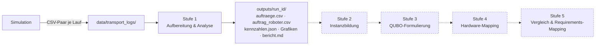

# Architektur

Das Projekt ist als **Pipeline in Stufen** aufgebaut. Jede Stufe liest die Ergebnisse der vorherigen Stufe aus Dateien und schreibt ihre eigenen Ergebnisse wieder als Dateien. Dadurch gilt:

- Jede Stufe lässt sich einzeln ausführen, prüfen und austauschen.
- Neue Simulationsläufe fließen automatisch durch alle Stufen.
- Verschiedene QUBO-Formulierungen und Hardware-Ziele werden später auf **exakt denselben** Instanzen verglichen.

Aktuell ist nur **Stufe 1** umgesetzt. Die Stufen 2–5 beschreiben die geplante Richtung. Ihre Details werden erst entschieden, wenn die Daten aus Stufe 1 verstanden sind.

## Datenfluss

Durchgezogene Pfeile sind umgesetzt, gestrichelte geplant.

## Die Stufen

### Stufe 1 – Aufbereitung & Analyse ✅

- **Ordner:** [`analysis/`](../analysis/README.md)
- **Eingabe:** Rohdaten-Paare aus `data/transport_logs/`
- **Ausgabe:** `outputs/<run_id>/` mit normalisierten Tabellen, Kennzahlen, Grafiken und Bericht sowie `outputs/laeufe_uebersicht.*`
- **Beantwortet:**
  - Wie sieht das Ursprungsproblem aus?
  - Wie viele Aufträge kommen wann?
  - Welche Roboter kommen jeweils in Frage, und wie weit sind sie entfernt?
  - Wie ausgelastet ist die Flotte?
  - Wo sind die Daten lückenhaft oder auffällig?

### Stufe 2 – Instanzbildung (geplant)

Schneidet aus dem kontinuierlichen Log einzelne **Zuweisungsprobleme**. Jedes Problem besteht aus einer Menge offener Aufträge, der Menge in Frage kommender Roboter und den Kosten je Paar. Die Ausgabe ist ein hardware-unabhängiges Instanzformat.

Wie geschnitten wird, ist noch offen (siehe [Offene Designfragen](#offene-designfragen)). Grafik 8 und die Kandidatenmengen aus Stufe 1 sind die Datengrundlage für diese Entscheidung.

### Stufe 3 – QUBO-Formulierung (geplant)

Übersetzt jede Instanz in QUBOs mit den Encodings **One-Hot**, **Domain Wall** und **Binary**. Mögliche Metriken je QUBO:

- Anzahl logischer Variablen
- Anzahl quadratischer Terme
- Dichte und Maximalgrad des Kopplungsgraphen
- Dynamikbereich der Koeffizienten
- Penalty-Gewichte

### Stufe 4 – Hardware-Mapping (geplant)

Bildet die QUBOs auf Zielarchitekturen ab und misst die physikalischen Ressourcen. Welche Architekturen das sind, ist noch nicht festgelegt.

### Stufe 5 – Vergleich & Requirements-Mapping (geplant)

Wertet über alle Läufe und Encodings aus, welche Problemmerkmale welche Hardwareanforderungen treiben. Problemmerkmale sind etwa die Größe der Kandidatenmengen, die Gleichzeitigkeit von Aufträgen oder die Kostenstreuung. Daraus entsteht die Zuordnung Problemklasse → Formulierung → Hardware.

## Zwei Oberflächen für dieselbe Pipeline

Jede Stufe hat zwei Gesichter, die auf **denselben Python-Funktionen** aufbauen:

| | Skripte & Berichte | Lernlabor (Website) |
| --- | --- | --- |
| Zweck | reproduzierbare Ergebnisse, Abbildungen fürs Paper | intuitiv erkunden und verstehen |
| Stufe 1 | `analysis/analysis.py` → PNG-Bericht | Reiter **1 · Daten** ([webapp/](../webapp/README.md)) |
| Kodierungen | `encodings/` (Lesekapitel), `encodings/formulations.py`, `encodings/baukasten.py` | Reiter **2 · Kodierungen IA** (Sofortzuweisung): One-Hot, Domain Wall und Binary (mit Hilfsbits) in den Fällen T = R, T < R, T > R ✅ · Reiter **3 · Kodierungen TA** (mit Reihenfolge, Ziel Lastausgleich, `encodings/workload.py`): One-Hot ✅, Domain Wall ✅, Binary ✅ · Archiv: One-Hot + Reihenfolge ✅, Diagonal-Seiten ✅, Formel-Baukasten ✅ |
| Qubits & Kopplungen | `encodings/resources.py` | Reiter **4 · Qubits & Kopplungen**: für eine Instanz Qubits gegen Kopplungen je Kodierung, IA und TA nebeneinander ✅ |
| Hardware-Abbildung | `hw/`, `run_all.py` | Reiter **5 · Hardware**: Einbettung/Routing der QUBOs auf D-Wave, IBM, Quantinuum; Schritt 1 (Pegasus) ✅, weitere folgen – Reiter liest nur `results/*.json` |

Die Website rechnet nichts Eigenes am Ursprungsproblem. Ihre Datenschicht (`webapp/data_service.py`) ruft `analysis/` auf, deshalb zeigen Bericht und Website immer dieselben Zahlen. Neue Berechnungen gehören zuerst in die Python-Module; die Website stellt sie dar.

## Designprinzipien

1. **Rohdaten sind unveränderlich.** Alles Abgeleitete landet in `outputs/` und ist per Skript reproduzierbar. Deshalb ist `outputs/` nicht versioniert.
2. **Ein Lauf = eine `run_id`** durch alle Stufen. Die `run_id` ist der Zeitstempel im Dateinamen der Simulation.
3. **Annahmen sind explizit.** Sie stehen an genau einer Stelle im Code und werden in jedem Bericht aufgeführt. Beispiele sind die Zuordnung eines Auftrags zu einem Bereich (`loader.task_area`) und der Sentinel-Schwellwert (`loader.PATH_SENTINEL_THRESHOLD`).
4. **Kennzahlen pro Lauf als JSON** (`kennzahlen.json`). Daraus wird die Lauf-Übersicht gebaut, sie wächst also mit jedem neuen Lauf automatisch mit.
5. **Stabile Farben in Grafiken.** Ein Bereich oder Status hat in jedem Lauf dieselbe Farbe, sodass Grafiken verschiedener Läufe direkt vergleichbar sind.

## Offene Designfragen

Diese Fragen sollten vor Stufe 2 auf Basis der Stufe-1-Ergebnisse geklärt werden:

- **Instanzschnitt:** Wie wird aus dem Log ein Zuweisungsproblem? Mögliche Varianten:
  - Zeitfenster fester Länge
  - Rekonstruktion der tatsächlich offenen Aufträge (braucht zusätzliche Events, siehe [DATENFORMAT.md](DATENFORMAT.md#wunschliste-an-die-simulation))
  - Gesamthorizont
- **Kandidatendefinition:** Reicht `available = True`? Empirisch gilt das für die Status `IDLE` *und* `MOVING_TO_BASE`. Wie wird die Zuständigkeit (`area_of_responsibility`) auf einen Auftrag bezogen?
- **Problemklasse:** Zwei Klassen sind umgesetzt.
  - **Sofortzuweisung** (`one_hot`, Gerkey & Matarić: IA): jeder Roboter höchstens ein Auftrag.
  - **Zuweisung mit Reihenfolge** (`one_hot_sequence`, TA): mehrere Aufträge nacheinander, mit Positions-Hilfsvariablen $x_{t,r,q}$.
  - **Zuweisung mit Reihenfolge, Ziel Lastausgleich** (`workload.wb_formulation`, TA): $H = H_{obj} + A\,H_{pen} + B\sum_r (L_{r,0} + \sum_t c_{t,r} x_{t,r})^2$ in One-Hot, Domain Wall und Binary – ohne Positionen, weil die Last nicht von der Reihenfolge abhängt.

  Welche Klasse zu einem Instanzschnitt passt, hängt davon ab, wie viele Aufträge je Entscheidung anfallen. Bei mehr Aufträgen als freien Robotern ist die Sofortzuweisung nicht lösbar.
- **Kostenfunktion / Bewertungskriterium:** Teilweise beantwortet durch [`encodings/cost_model.py`](../encodings/cost_model.py).
  - **Sofortzuweisung:** Wählbar sind Leerfahrt, Fahrstrecke, Fahr-, Bearbeitungs-, Erledigungs- und Durchlaufzeit, Verspätung, Energie, Betriebskosten und eine gewichtete Kombination. Sie füllen nur die **Diagonale**, und zwar nur, weil jeder Roboter höchstens einen Auftrag bekommt.
  - **Mit Reihenfolge:** Summe der Erledigungszeiten und Summe der Arbeitszeiten (`SEQUENCE_CRITERIA`). Sie brauchen Platz-Hilfsvariablen und Kopplungen zwischen benachbarten Plätzen, siehe [encodings/reihenfolge/](../encodings/reihenfolge/README.md).

  Offen bleiben:
  - Welche Annahmen (Geschwindigkeit, Ladezeiten, Energie- und Kostensätze, Fälligkeiten) realistisch sind; die Simulation loggt sie bisher nicht.
  - Wie die übrigen **Struktur-Kriterien** formuliert werden: Makespan, Auslastung/Balancing, Durchsatz, Anzahl zugewiesener Aufträge. Mit Reihenfolge kommen dazu: Verspätung (braucht Schlupfvariablen für max(0, ·)) und spätere Anfragezeiten (release dates, braucht ein Zeitraster).
  - Die geloggten Pfadlängen weichen deutlich von der Manhattan-Distanz ab (Grafik 6). Die Lastfahrt nutzt die Pfadlänge, die Anfahrt mangels Roboter-Pfaden die Manhattan-Distanz.
- **Sonderfälle:** Umgang mit Aufträgen ohne in Frage kommenden Roboter (im ersten Lauf ca. 20 %) und mit Sentinel-Pfadlängen.
