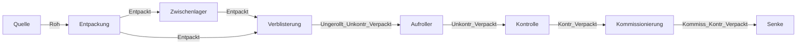

# Datenformat der Simulationslogs

Jeder Simulationslauf liefert **zwei CSV-Dateien mit gleichem Zeitstempel-Suffix**:

| Datei | Inhalt | Granularität |
| --- | --- | --- |
| `transport_events_<run_id>.csv` | Transportanfragen | eine Zeile pro Anfrage |
| `transport_fleet_<run_id>.csv` | Flotten-Snapshot zum Zeitpunkt jeder Anfrage | eine Zeile pro (Anfrage, Roboter) |

Formatdetails:
- Trennzeichen `;`, erste Zeile Header, Dezimalpunkt `.`
- Verknüpft werden die Dateien über `transport_id`.
- Die `run_id` ist der Startzeitpunkt der Simulation (`YYYY-MM-DD_HH-MM-SS`).

Der Stand dieser Beschreibung ist Lauf `2026-10-09_12-59-39`. Neue Läufe können zusätzliche Werte enthalten; die Analyse meldet Unbekanntes im Bericht.

## `transport_events_*.csv`

| Spalte | Typ | Bedeutung | Beobachtung |
| --- | --- | --- | --- |
| `transport_id` | int | eindeutige, fortlaufende ID der Anfrage | 1…88 |
| `time` | float | Simulationszeit der Anfrage in Sekunden | gemischtes Format (`90`, `1.0`) |
| `event` | text | Ereignistyp | ältere Läufe nur `REQUESTED`; ab Lauf `2026-10-22_17-38-15` der Lebenslauf: `REQUESTED`, `ASSIGNED`, `PICKED_UP`, `COMPLETED`, `ABORTED` |
| `time_since_requested` | float | Sekunden seit der Anfrage (neuere Läufe) | bei `ASSIGNED` = Wartezeit bis zur Zuweisung |
| `material_id` | text | transportiertes Material, siehe [Materialnamen](#materialnamen) | **als Text lesen** (führende Nullen) |
| `carrier_id` | text | Ladungsträger | ab `PICKED_UP` gefüllt, z.B. `Carrier: verpackt_blister_carrier:300000` |
| `from_entity` | text | Abholort, siehe [Entitätsnamen](#entitätsnamen) | |
| `from_entity_x`, `from_entity_y` | int | Koordinaten des Abholorts (Gitterzellen) | |
| `to_entity` | text | Zielort | |
| `to_entity_x`, `to_entity_y` | int | Koordinaten des Zielorts | |
| `shortest_path_number_of_steps_in_path` | int | Länge des kürzesten Pfads Abholort → Ziel in Schritten | `10000` = vermutlich „unerreichbar“ |
| `vehicle_id` | text | ausführender Agent | bei `REQUESTED` leer; sonst `TransportRobot: 61` oder `Worker: 42` (Werker) |
| `info` | text | Freitext | z.B. Abbruchgrund `MissingProductionMaterialError`, `conveyor` bei Abschluss per Förderband |

## `transport_fleet_*.csv`

| Spalte | Typ | Bedeutung | Beobachtung |
| --- | --- | --- | --- |
| `transport_id` | int | Anfrage, zu deren Zeitpunkt der Snapshot entstand | 4 Zeilen (Roboter) je Anfrage |
| `time` | float | Simulationszeit, identisch mit der Anfrage | |
| `vehicle_id` | text | Roboter, z.B. `TransportRobot: 61` | Roboter 61–64 |
| `status` | text | Zustand des Roboters | `IDLE`, `MOVING_TO_PICKUP`, `LOADING`, `MOVING_TO_DROP_OFF`, `MOVING_TO_BASE` |
| `x`, `y` | int | Position des Roboters (Gitterzellen) | |
| `battery_percent` | float | Ladezustand in % | konstant `15.0` |
| `area_of_responsibility` | text | Bereiche, für die der Roboter zuständig ist, `\|`-getrennt | alle Roboter: alle 5 Bereiche |
| `available` | bool | Roboter kann einen neuen Auftrag annehmen | `True` genau bei `IDLE` und `MOVING_TO_BASE` |
| `reserved_for_transport_id` | int | Auftrag, für den der Roboter reserviert ist (neuere Läufe) | leer, wenn frei |

## Entitätsnamen

| Muster | Art | Beispiel |
| --- | --- | --- |
| `Ma: <Bereich>:<Nr>` | Maschine | `Ma: Verblisterung:1202` |
| `IntermediateStore: <Nr>` | Zwischenlager | `IntermediateStore: 52` |
| `Source: <Nr>` | Quelle (Rohmaterial) | `Source: 21` |
| `Sink: <Nr>` | Senke (fertige Ware) | `Sink: 31` |

Bisher gibt es diese Maschinenbereiche, jeweils mit eigenem Nummernkreis:

| Bereich | Nummern |
| --- | --- |
| `ENTPACKUNG` | 11xx |
| `VERBLISTERUNG` | 12xx |
| `AUFROLLER` | 13xx |
| `KONTROLLE` | 14xx |
| `KOMMISSIONIERUNG` | 17xx |

In `area_of_responsibility` stehen die Bereichsnamen in Großbuchstaben.

## Materialnamen

Muster: `[<Stufe>_]<Produktnummer>[x<Menge>]`. Beispiel: `Kontr_Verpackt_18424930x1` bedeutet Stufe `Kontr_Verpackt`, Produkt `18424930`, Menge 1. Eine reine Produktnummer ohne Präfix ist Rohmaterial aus der Quelle.

Die Stufen spiegeln den Produktionsprozess:

Daneben gibt es Transporte von entpacktem Material zwischen Verblisterungsmaschinen und Zwischenlagern (siehe Grafik 2 im Bericht).

## Koordinaten

- Ganzzahlige Gitterzellen, im ersten Lauf x 0–63 und y 1–25.
- Die Orientierung der y-Achse in der Simulation ist nicht dokumentiert; die Grafiken zeigen y nach oben.
- Die Roboter-Basen sind nicht explizit geloggt. Die Analyse leitet sie aus der häufigsten Position im Zustand `IDLE` ab.

## Bekannte Auffälligkeiten

Stand Lauf `2026-10-09_12-59-39`. Der Bericht jedes Laufs listet die aktuellen Befunde automatisch.

- **Lebenszyklus erst ab Lauf `2026-10-22_17-38-15`.** Ältere Läufe enthalten nur `REQUESTED`. Bei neueren Läufen liest der Loader Anfragen und Lebenslauf getrennt; je Auftrag entstehen Zuweisung, Abholung, Abschluss oder Abbruch, Wartezeit bis zur Zuweisung und Durchlaufzeit.
- **Werker übernehmen Aufträge** (`Worker: 42/43`), tauchen aber nicht in den Flotten-Snapshots auf – für sie fehlen Position und Verfügbarkeit.
- **Abschluss per Förderband:** `COMPLETED` ohne Fahrzeug mit `info = conveyor`.
- **BOM am Dateianfang** in neueren Dateien (unsichtbares Zeichen vor `transport_id`); der Loader entfernt es.
- **Sentinel `10000`** in `shortest_path_number_of_steps_in_path` (transport_id 11). Ungefiltert würde er jede Kosten- oder Koeffizientenskala dominieren.
- **Pfadlänge ≠ Manhattan-Distanz.** In 39 von 88 Fällen ist der Pfad *kürzer* als die Manhattan-Distanz der Entitätskoordinaten. Die Pfadlänge bezieht sich vermutlich auf Zugangspunkte statt auf die Entitätskoordinaten.
- **Keine Variation bei Batterie und Zuständigkeiten.** Batterie konstant 15 %, alle Roboter für alle Bereiche zuständig. Die Kandidatenmengen hängen deshalb bisher nur von `available` ab.
- **Gemischtes Zeitformat** (`90` vs. `1.0`).
- **Führende Nullen** in Produktnummern (`01401362`). Wer die Daten ohne Text-Typisierung einliest, verliert sie.

## Wunschliste an die Simulation

Nach Nutzen für die spätere QUBO-Analyse sortiert:

1. ~~**Lebenszyklus-Events**~~ ✅ seit Lauf `2026-10-22_17-38-15` vorhanden. Offen: Position und Verfügbarkeit der **Werker** in den Flotten-Snapshots mitloggen, damit sie als Kandidaten in die Zuweisung eingehen können.
2. **Bedeutung von `10000` dokumentieren**, besser ein eigenes Feld (z.B. `path_reachable`).
3. **Szenarien variieren:** heterogene Zuständigkeiten, unterschiedliche Batteriestände, mehr Roboter, höhere Auftragslast. So entsteht die Spannweite an Problemstrukturen, die der Hardware-Vergleich braucht.
4. **Distanz bzw. Pfadlänge Roboter → Abholort** je Snapshot loggen, damit die Kosten konsistent zur Pfadplanung der Simulation sind.
5. **Einheitliches Zeitformat.**
