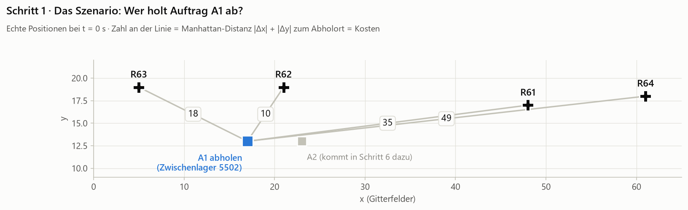
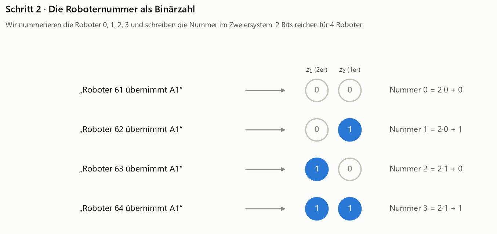
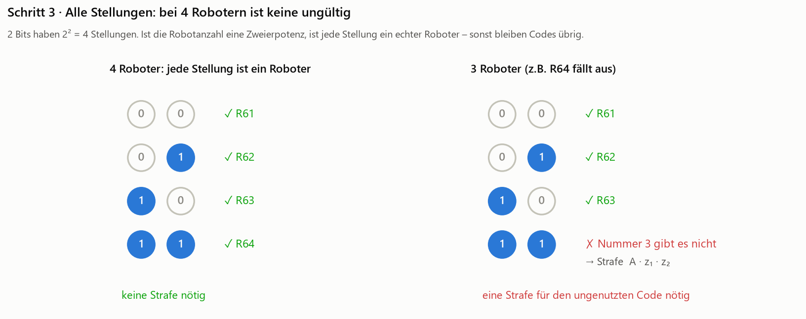
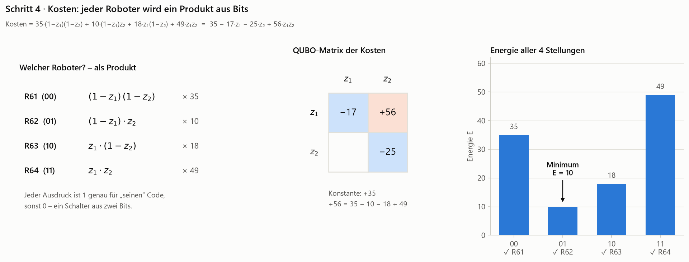
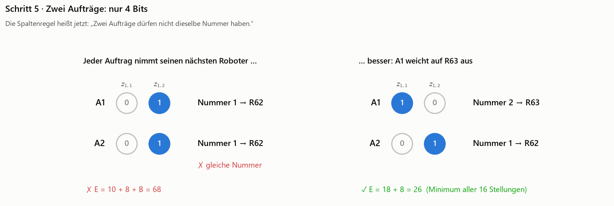
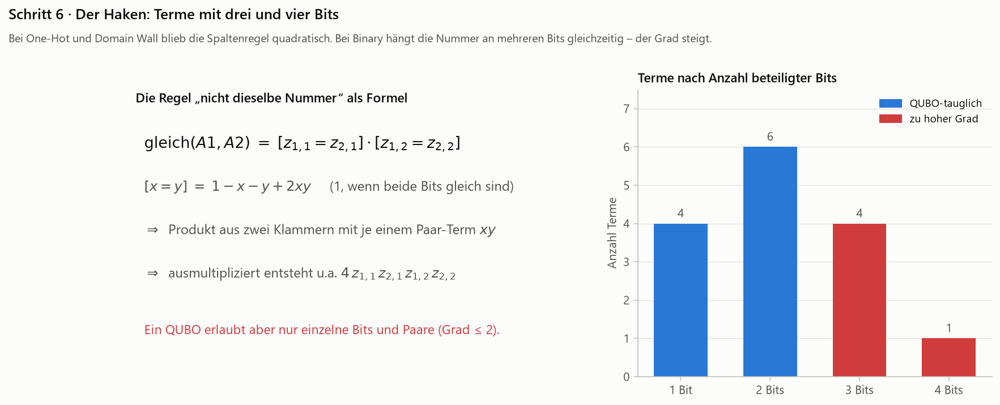
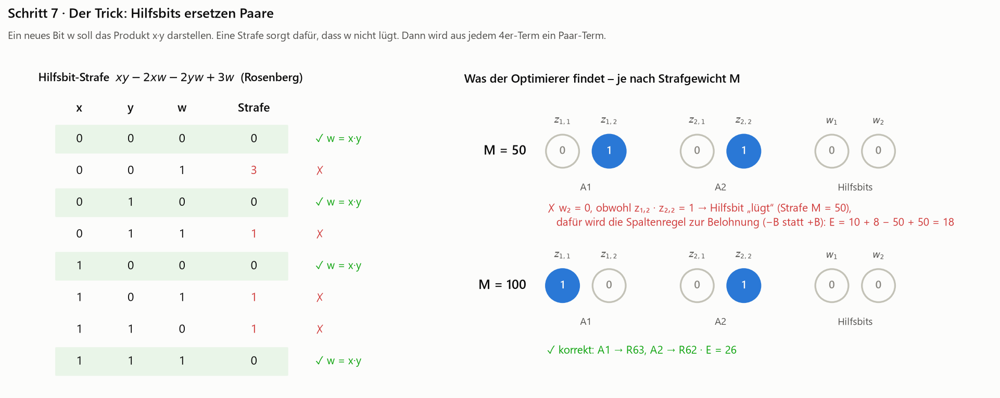
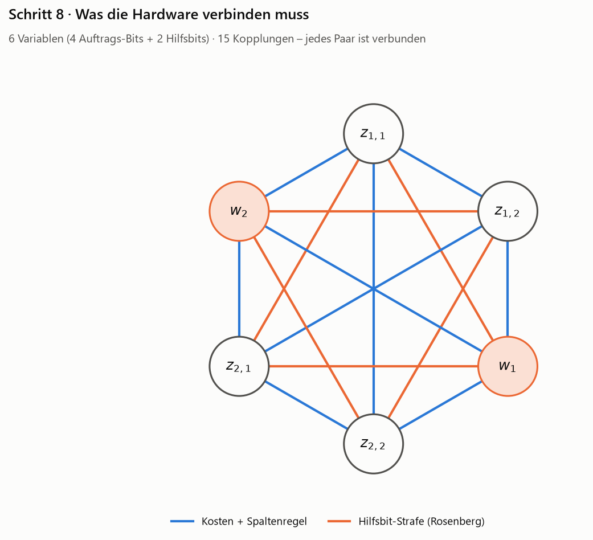
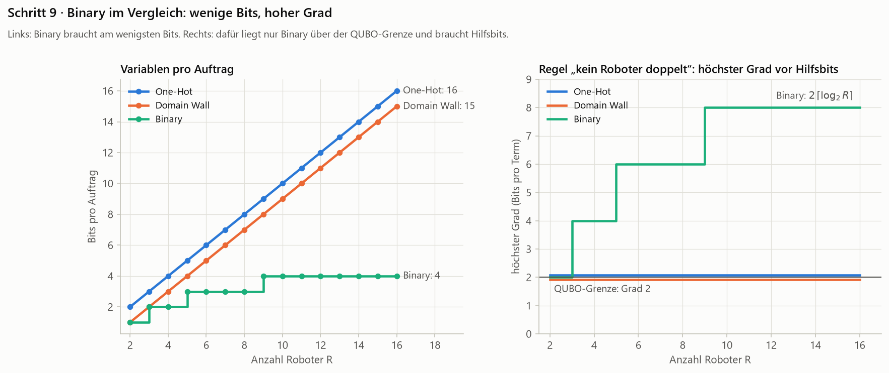

# Binary-Kodierung – „Die Roboternummer als Binärzahl“

> **Kurzfassung:** Wir nummerieren die Roboter und schreiben die Nummer im Zweiersystem. Für $R$ Roboter reichen $\lceil \log_2 R \rceil$ Bits – bei 4 Robotern zwei, bei 16 Robotern vier. Das spart radikal Variablen. Der Preis: Die Bits eines Auftrags arbeiten nur noch **gemeinsam**. Regeln wie „kein Roboter doppelt“ erzeugen dadurch Terme mit drei und vier Bits, die erst mit **Hilfsbits** und großen Strafgewichten auf QUBO-Form gebracht werden müssen.

Dieses Kapitel baut auf [One-Hot](../one_hot/README.md) und [Domain Wall](../domain_wall/README.md) auf und nutzt dasselbe Beispiel.

1. [Die kürzeste Schreibweise](#schritt-1--die-kürzeste-schreibweise)
2. [Die Roboternummer als Binärzahl](#schritt-2--die-roboternummer-als-binärzahl)
3. [Alle Stellungen – und wann es doch ungültige gibt](#schritt-3--alle-stellungen--und-wann-es-doch-ungültige-gibt)
4. [Kosten: jeder Roboter wird ein Produkt aus Bits](#schritt-4--kosten-jeder-roboter-wird-ein-produkt-aus-bits)
5. [Zwei Aufträge: nur 4 Bits](#schritt-5--zwei-aufträge-nur-4-bits)
6. [Der Haken: Terme mit drei und vier Bits](#schritt-6--der-haken-terme-mit-drei-und-vier-bits)
7. [Der Trick: Hilfsbits ersetzen Paare](#schritt-7--der-trick-hilfsbits-ersetzen-paare)
8. [Was die Hardware verbinden muss](#schritt-8--was-die-hardware-verbinden-muss)
9. [Binary im Vergleich](#schritt-9--binary-im-vergleich)

---

## Schritt 1 · Die kürzeste Schreibweise



Gleiches Szenario: t = 0 s, vier freie Roboter, Auftrag A1. Die Kosten sind 35 / **10** / 18 / 49.

Bisher brauchten wir 4 Bits (One-Hot) bzw. 3 Bits (Domain Wall), um eine von vier Möglichkeiten zu beschreiben. Dabei weiß jeder, der schon einmal Binärzahlen gesehen hat: **Mit 2 Bits kann man bis 4 zählen.** Warum also nicht einfach die Roboternummer im Zweiersystem aufschreiben? Weniger Bits heißt weniger Qubits – auf heutiger Hardware die knappste Ressource.

---

## Schritt 2 · Die Roboternummer als Binärzahl



Wir geben den Robotern die Nummern 0 bis 3 und schreiben sie mit zwei Bits:

- $z_1$ ist die **2er-Stelle**, $z_2$ die **1er-Stelle**.
- Die Nummer ist $2 z_1 + z_2$: `00` = 0 → R61, `01` = 1 → R62, `10` = 2 → R63, `11` = 3 → R64.

> **Merke:** Binary braucht $\lceil \log_2 R \rceil$ Bits pro Auftrag. Das ist die kleinstmögliche Zahl – weniger Bits können gar nicht $R$ verschiedene Antworten unterscheiden.

---

## Schritt 3 · Alle Stellungen – und wann es doch ungültige gibt



**Links, 4 Roboter:** Zwei Bits haben genau 4 Stellungen, und jede ist ein echter Roboter. Es gibt **keine ungültige Stellung** – also brauchen wir für einen einzelnen Auftrag **überhaupt keine Strafe**. Das ist der große Vorteil gegenüber One-Hot und Domain Wall.

**Rechts, 3 Roboter** (z.B. weil R64 nicht verfügbar ist): Jetzt bleibt der Code `11` übrig – eine Nummer, zu der es keinen Roboter gibt. Was passiert ohne Strafe? Für `11` gibt es keinen Kostenterm, der „Phantomroboter“ kostet also **0** und schlägt jeden echten Roboter. Der Optimierer würde ihn wählen. Abhilfe schafft die Strafe $A \cdot z_1 z_2$, die genau bei `11` greift. Mit $A = 50$ gewinnt wieder R62 mit $E = 10$.

Das ist der Normalfall, denn in den Daten schwankt die Zahl der verfügbaren Roboter ständig (siehe Grafik 5 im [Analysebericht](../../outputs/2026-10-09_12-59-39/bericht.md)). Und es wird schnell unangenehm: Bei 5 Robotern braucht man 3 Bits, die Codes 5, 6, 7 sind ungültig, und ihre Strafe enthält bereits einen **Term mit drei Bits** – der ist im QUBO nicht erlaubt.

---

## Schritt 4 · Kosten: jeder Roboter wird ein Produkt aus Bits



Bei One-Hot gab es für jeden Roboter ein eigenes Bit, das „Roboter gewählt“ bedeutete. Bei Binary gibt es das nicht mehr. Wir müssen es aus beiden Bits **zusammenbauen** (linkes Bild): R62 (`01`) ist gewählt, wenn $z_1 = 0$ **und** $z_2 = 1$, also $(1 - z_1) \cdot z_2$. Das ist wie ein Schalter, der nur umspringt, wenn zwei Bedingungen gleichzeitig erfüllt sind.

Die Kosten sind dann:

$$35(1-z_1)(1-z_2) + 10(1-z_1)z_2 + 18\,z_1(1-z_2) + 49\,z_1 z_2 \;=\; 35 - 17\,z_1 - 25\,z_2 + 56\,z_1 z_2$$

Was fällt auf?

- **Schon die Kosten brauchen eine Kopplung** ($z_1 z_2$). Bei One-Hot und Domain Wall waren die Kosten rein linear.
- **Die Kosten eines Roboters stecken nicht mehr in einem Koeffizienten.** Die 56 ist $35 - 10 - 18 + 49$ – eine Mischung aus allen vier. Die Matrix ist kaum noch „lesbar“.
- Rechts die Energie aller 4 Stellungen: Sie ist genau die Distanz, und das Minimum ist R62 mit $E = 10$.

Mit 4 Robotern sind die Produkte noch Paare, also QUBO-tauglich. Bei 8 Robotern hätte jedes Produkt drei Bits, und dann sind **schon die Kosten eines einzelnen Auftrags** nicht mehr quadratisch.

---

## Schritt 5 · Zwei Aufträge: nur 4 Bits



Auftrag A2 kommt dazu (Distanzen 29 / **8** / 24 / 43). Zwei Aufträge brauchen nur **4 Bits** – halb so viele wie One-Hot.

Die Spaltenregel heißt jetzt: **„Zwei Aufträge dürfen nicht dieselbe Nummer haben.“** Das Ergebnis ist wie gehabt: Stur „jeder nimmt den nächsten“ ergibt zweimal Nummer 1 und kostet $10 + 8 + B = 68$. Das Minimum über alle $2^4 = 16$ Stellungen ist **A1 → R63, A2 → R62** mit $E = 26$.

So weit, so gut. Der Haken steckt darin, *wie* man „dieselbe Nummer“ als Formel schreibt.

---

## Schritt 6 · Der Haken: Terme mit drei und vier Bits



Zwei Nummern sind gleich, wenn **jede Stelle** gleich ist:

$$\text{gleich}(A1, A2) = [z_{1,1} = z_{2,1}] \cdot [z_{1,2} = z_{2,2}], \qquad [x = y] = 1 - x - y + 2xy$$

Jede Klammer enthält schon einen Paar-Term $xy$. Das Produkt zweier Klammern enthält deshalb Terme mit **drei und vier Bits**, zum Beispiel $4\, z_{1,1} z_{2,1} z_{1,2} z_{2,2}$. Rechts im Bild sind alle Terme nach Grad gezählt: 4 mit einem Bit, 6 mit zwei, **4 mit drei** und **1 mit vier** Bits.

Ein QUBO erlaubt aber nur einzelne Bits und Paare. Die Formel ist also **kein QUBO**, und die Hardware kann sie so nicht verarbeiten.

Warum war das bei One-Hot und Domain Wall kein Problem? Dort gab es für jeden Roboter einen Ausdruck, der **linear** in den Bits ist ($x_r$ bzw. $b_k - b_{k+1}$). Das Produkt zweier linearer Ausdrücke ist quadratisch. Bei Binary ist schon der Ausdruck „Roboter gewählt“ ein Produkt, und das Produkt zweier Produkte hat einen höheren Grad.

---

## Schritt 7 · Der Trick: Hilfsbits ersetzen Paare



Die Standardlösung (Rosenberg, 1975): Wir führen für jedes störende Produkt ein **neues Bit** $w$ ein, das *so tun soll*, als wäre es $x \cdot y$. Damit es das auch wirklich tut, bekommt es eine eigene Strafe:

$$M \cdot (xy - 2xw - 2yw + 3w)$$

Die Tabelle links zeigt alle 8 Fälle. Die Strafe ist **genau dann 0, wenn $w = x \cdot y$** (grün), sonst mindestens 1.

Für unser Beispiel brauchen wir zwei Hilfsbits: $w_1$ für $z_{1,1} z_{2,1}$ und $w_2$ für $z_{1,2} z_{2,2}$. Dann wird jede Klammer $[x = y] = 1 - x - y + 2w$ **linear**, und ihr Produkt ist wieder quadratisch – ein echtes QUBO.

Aber wie groß muss $M$ sein? Rechts sieht man, was passiert:

**$M = 50$ – zu klein.** Der Optimierer findet einen Trick. Beide Aufträge nehmen R62 (`01`/`01`). Eigentlich müsste $w_2 = 1$ sein (beide zweiten Bits sind 1), aber $w_2$ „lügt“ und bleibt 0. Das kostet die Strafe $M = 50$. Im Gegenzug wird die Klammer $[z_{1,2} = z_{2,2}]$ zu $1 - 1 - 1 + 0 = -1$. Aus der Spaltenstrafe $+B$ wird dadurch eine *Belohnung* $-B$. Unterm Strich: $10 + 8 - 50 + 50 = 18 < 26$. Die Lüge lohnt sich.

**$M = 100$ – ausreichend.** Jetzt ist Lügen teurer, als es einbringt. Für jede Stellung der Auftrags-Bits ergibt das Minimum über die Hilfsbits genau die richtige Energie (nachgerechnet für alle 16). Das Optimum ist wieder A1 → R63, A2 → R62 mit $E = 26$.

> **Merke:** Hilfsbits kosten doppelt – **zusätzliche Qubits** und **große Strafgewichte**. Die großen Gewichte treiben den Wertebereich der Koeffizienten nach oben: Im Beispiel ist der größte Koeffizient 400, bei One-Hot und Domain Wall 100. Das verschärft die **Präzisionsanforderung an die Hardware**.

---

## Schritt 8 · Was die Hardware verbinden muss



Nach dem Hilfsbit-Trick haben wir **6 Variablen** (4 Auftrags-Bits + 2 Hilfsbits) und **15 Kopplungen**. Das sind *alle* möglichen Paare zwischen 6 Knoten: ein vollständiger Graph.

- **Blau:** Kopplungen aus Kosten und Spaltenregel.
- **Orange:** Kopplungen aus den Hilfsbit-Strafen.

Im direkten Vergleich für unser Beispiel:

| | One-Hot | Domain Wall | Binary |
| --- | --- | --- | --- |
| Variablen | 8 | 6 | 6 (davon 2 Hilfsbits) |
| Kopplungen | 16 | 11 | 15 (alle Paare) |
| größter Koeffizient | 100 | 100 | 400 |

Die gesparten Auftrags-Bits werden also zum Teil durch Hilfsbits wieder aufgefressen. Die Verbindungsstruktur ist die dichteste von allen drei.

---

## Schritt 9 · Binary im Vergleich



**Links:** Bits pro Auftrag. Binary wächst nur logarithmisch: 4 Bits für 16 Roboter statt 16 (One-Hot) oder 15 (Domain Wall).

**Rechts:** Höchster Grad der Regel „kein Roboter doppelt“, *bevor* Hilfsbits eingesetzt werden. One-Hot und Domain Wall bleiben immer bei 2 – genau an der QUBO-Grenze. Bei Binary ist der Grad $2\lceil \log_2 R \rceil$: Je mehr Roboter, desto höher der Grad, desto mehr Hilfsbits und desto größere Strafgewichte.

Binary lohnt sich daher vor allem dort,

- wo **Qubits** die knappste Ressource sind,
- wo die Robotanzahl eine **Zweierpotenz** ist (keine ungültigen Codes), und
- wo die Hardware **Terme höheren Grades** direkt verarbeiten kann – etwa bei gatterbasierten Verfahren wie QAOA, wo Glos et al. (2022) genau diesen Kompromiss aus weniger Qubits und tieferen Schaltkreisen untersuchen.

---

## Auf einen Blick

| | One-Hot | Domain Wall | Binary |
| --- | --- | --- | --- |
| Idee | ein Bit pro Roboter | Thermometer, Position der Wand | Roboternummer als Binärzahl |
| Bits pro Auftrag | $R$ | $R-1$ | $\lceil \log_2 R \rceil$ |
| Ungültige Stellungen pro Auftrag | $2^R - R$ | $2^{R-1} - R$ | $2^{\lceil \log_2 R \rceil} - R$ (0 bei Zweierpotenz) |
| Kosten eines Auftrags | linear | linear | Grad $\lceil \log_2 R \rceil$ |
| Spaltenregel | Grad 2 | Grad 2 | Grad $2\lceil \log_2 R \rceil$ → Hilfsbits nötig |
| Zwei Aufträge, 4 Roboter | 8 Var., 16 Kopplungen | 6 Var., 11 Kopplungen | 6 Var. (2 Hilfsbits), 15 Kopplungen |
| größter Koeffizient (Beispiel) | 100 | 100 | 400 |

## Zum Nachrechnen

```powershell
python encodings/binary/illustrate.py
```

Das Skript erzeugt alle Abbildungen neu und prüft jede Zahl dieses Textes durch Ausprobieren aller Zustände, auch die Aussagen zu 3, 5 und 8 Robotern. Dabei wird auch geprüft, dass das Polynom vom Grad 4 *kein* QUBO ist und dass $M = 50$ tatsächlich zum falschen Ergebnis führt.

## Literatur

- A. Glos, A. Krawiec, Z. Zimborás, „Space-efficient binary optimization for variational quantum computing“, *npj Quantum Information* 8, 39 (2022). [doi:10.1038/s41534-022-00546-y](https://doi.org/10.1038/s41534-022-00546-y) – Binary-Kodierung für Zuordnungsprobleme (TSP) im QAOA-Kontext.
- I. G. Rosenberg, „Reduction of bivalent maximization to the quadratic case“, *Cahiers du Centre d'Études de Recherche Opérationnelle* 17, 71–74 (1975) – der Hilfsbit-Trick aus Schritt 7.
