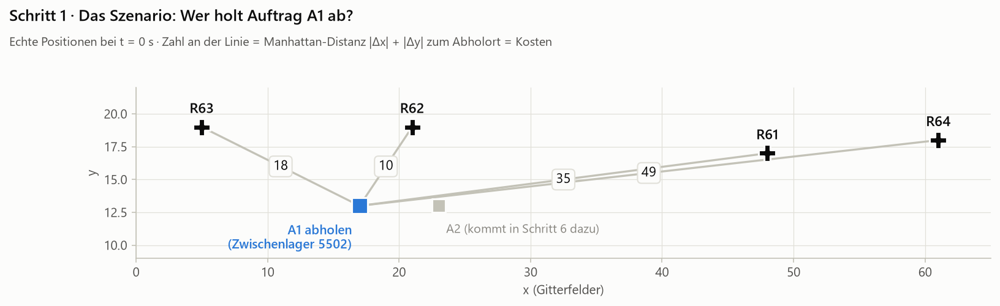
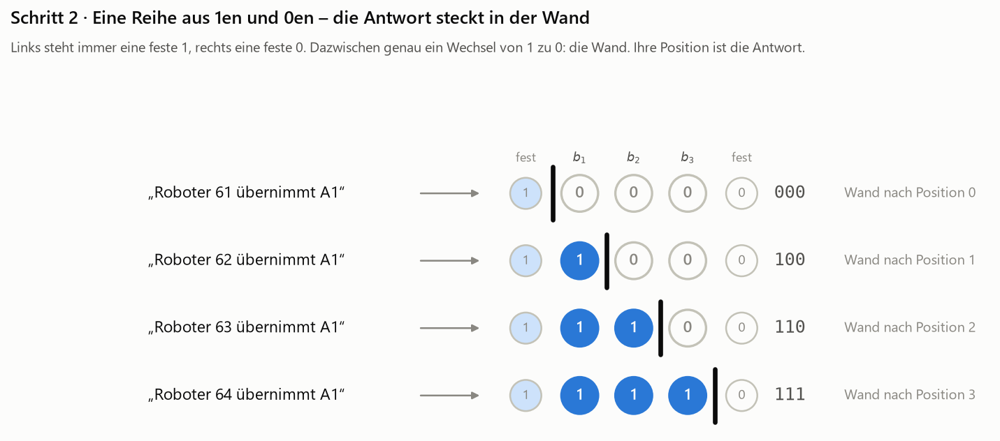
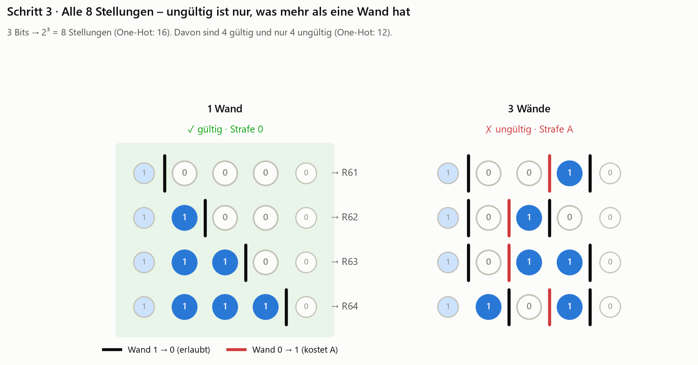
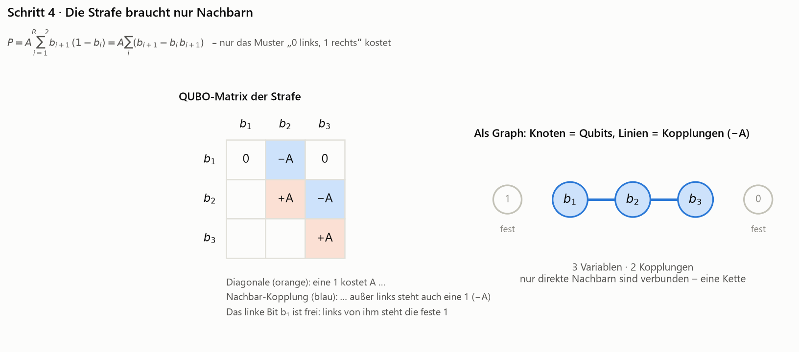
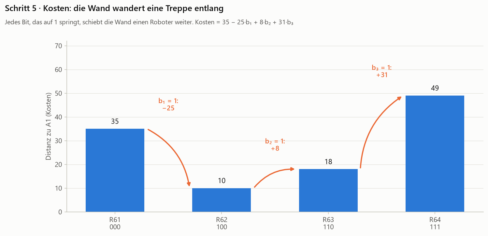
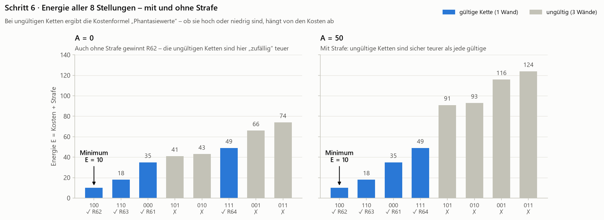
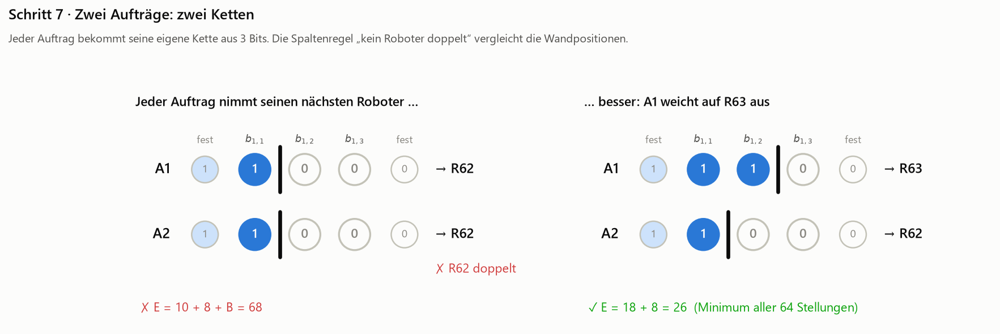
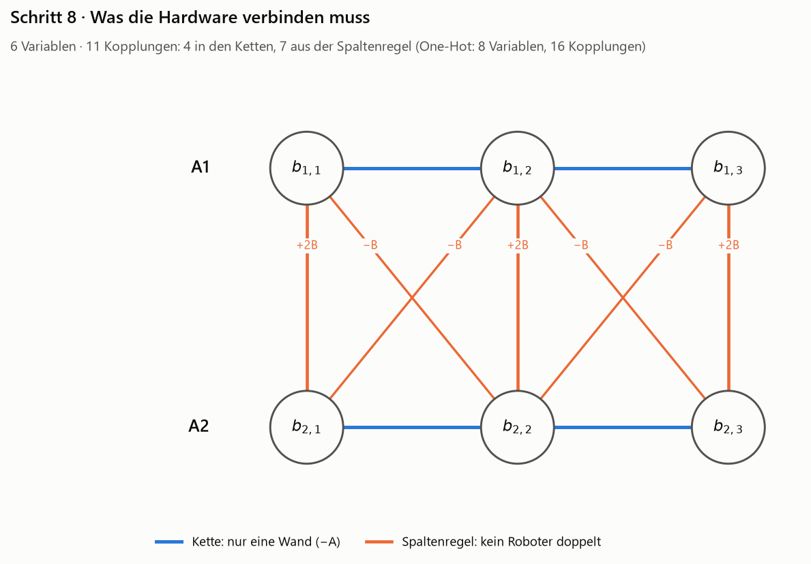
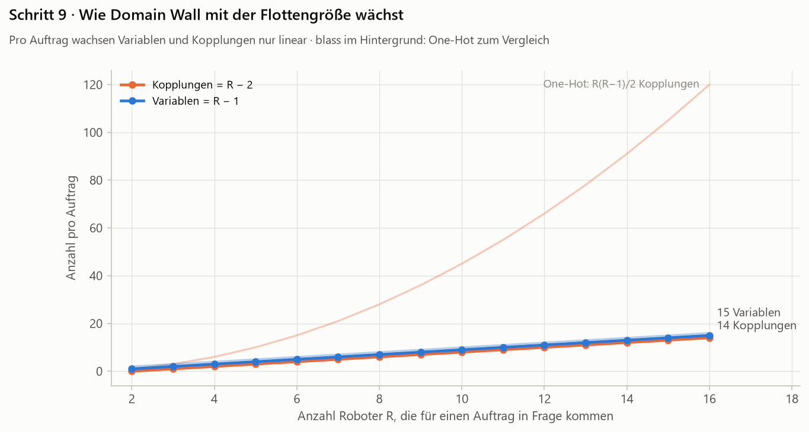

# Domain-Wall-Kodierung – „Die Antwort steckt in der Wand“

> **Stand 26.10.2026 – keine Spaltenregel mehr.** Im Projekt ist Doppelbelegung zulässig: Ein Roboter darf mehrere Aufträge übernehmen.
> Das Lernlabor und der Standard in [`formulations.py`](../formulations.py) verwenden deshalb keine Spaltenregel. Die Abschnitte zur
> Spaltenregel unten beschreiben die strengere Variante aus der Literatur (höchstens ein Auftrag je Roboter); sie ist mit
> `column_rule=True` weiter nachrechenbar und im Formel-Baukasten als Baustein „Gruppe je Roboter, höchstens eine Option“ baubar.

> **Kurzfassung:** Statt eines Schalters pro Roboter gibt es eine Reihe aus $R-1$ Bits, die wie ein Thermometer von links mit Einsen „gefüllt“ wird: `000`, `100`, `110`, `111`. Die Antwort ist die Stelle, an der die Einsen in Nullen übergehen – die **Wand**. Die Regel „nur eine Wand“ braucht nur Kopplungen zwischen **direkten Nachbarn**: eine Kette statt einer Clique. Die Kosten bleiben linear.

Dieses Kapitel baut auf dem [One-Hot-Kapitel](../one_hot/README.md) auf und nutzt dasselbe Beispiel. Wer One-Hot noch nicht kennt, liest am besten dort zuerst.

> **Interaktiv:** Lernlabor, Reiter **3 · Kodierungen TA › Domain Wall** (`python -m webapp --open`) – derselbe Weg an beliebigen echten Aufträgen, mit klickbaren Ketten. Formulierung: [`formulations.domain_wall`](../formulations.py), geprüft in [`tests/test_domain_wall.py`](../../tests/test_domain_wall.py).
> Sofortzuweisung mit Spaltenregel und den Fällen T = R, T < R, T > R (Kette je Auftrag bzw. je Roboter): Reiter **2 · Kodierungen IA › Domain Wall**, [`formulations.domain_wall_ia`](../formulations.py), geprüft in [`tests/test_ia_domain_wall.py`](../../tests/test_ia_domain_wall.py).

1. [Was uns an One-Hot gestört hat](#schritt-1--was-uns-an-one-hot-gestört-hat)
2. [Eine Reihe aus Einsen und Nullen](#schritt-2--eine-reihe-aus-einsen-und-nullen)
3. [Alle 8 Stellungen](#schritt-3--alle-8-stellungen)
4. [Die Strafe braucht nur Nachbarn](#schritt-4--die-strafe-braucht-nur-nachbarn)
5. [Kosten: die Wand wandert eine Treppe entlang](#schritt-5--kosten-die-wand-wandert-eine-treppe-entlang)
6. [Energie mit und ohne Strafe](#schritt-6--energie-mit-und-ohne-strafe)
7. [Zwei Aufträge: zwei Ketten](#schritt-7--zwei-aufträge-zwei-ketten)
8. [Was die Hardware verbinden muss](#schritt-8--was-die-hardware-verbinden-muss)
9. [Wie Domain Wall mit der Flottengröße wächst](#schritt-9--wie-domain-wall-mit-der-flottengröße-wächst)

---

## Schritt 1 · Was uns an One-Hot gestört hat



Gleiches Szenario wie bei One-Hot: t = 0 s, vier freie Roboter, Auftrag A1 am Zwischenlager 5502. Die Distanzen (= Kosten) sind 35 / **10** / 18 / 49 für R61 / R62 / R63 / R64.

Bei One-Hot hatten wir zwei Dinge gesehen, die für die Hardware unangenehm sind:

- **Viel Ausschuss:** Von 16 Bitmustern waren nur 4 sinnvoll. 12 Muster mussten wir per Strafe „wegdrücken“.
- **Jeder mit jedem:** Die Regel „genau eins“ verband jedes Bit mit jedem anderen – eine Clique.

Die Frage dieses Kapitels: **Geht es mit weniger Bits und weniger Verbindungen?**

---

## Schritt 2 · Eine Reihe aus Einsen und Nullen



Die Idee: Statt einer Lampe pro Roboter denken wir an ein **Thermometer**. Die Säule steigt von links; wie weit sie reicht, ist die Antwort.

So funktioniert es:

- Wir nehmen $R - 1 = 3$ Bits $b_1, b_2, b_3$.
- Ganz links denken wir uns eine **feste 1**, ganz rechts eine **feste 0** (im Bild blass). Diese beiden sind keine Variablen, nur gedachte Ränder.
- Weil links eine 1 und rechts eine 0 steht, muss es irgendwo dazwischen einen Wechsel von 1 auf 0 geben. Diese Stelle heißt **Wand** (*domain wall*).
- Wo die Wand steht, ist die Antwort: direkt hinter der festen 1 → R61, nach $b_1$ → R62, nach $b_2$ → R63, nach $b_3$ → R64.

Der Name kommt aus der Physik. Bereiche gleicher Ausrichtung in einem Magneten heißen *Domänen*, die Grenze dazwischen heißt *Domänenwand*. Unsere Einsen und Nullen sind die beiden Domänen.

> **Merke:** Domain Wall braucht **ein Bit weniger, als es Antwortmöglichkeiten gibt** – hier 3 Bits für 4 Roboter.

---

## Schritt 3 · Alle 8 Stellungen



Drei Bits haben $2^3 = 8$ Stellungen (One-Hot: 16). Links stehen die vier mit **genau einer Wand** – das sind genau unsere vier Roboter. Rechts die vier anderen: Sie haben **drei Wände**.

Warum nie zwei Wände? Weil links immer eine 1 und rechts immer eine 0 steht, muss man insgesamt einmal mehr „nach unten“ (1 → 0) als „nach oben“ (0 → 1) wechseln. Jede falsche Wand 0 → 1 (rot) bringt also automatisch eine weitere Wand 1 → 0 mit.

Das macht die Regel sehr einfach: **Bestraft wird jede Wand der Art 0 → 1.** Gibt es keine, ist die Kette gültig.

Und es gibt etwas, das bei One-Hot noch möglich war und hier gar nicht ausgedrückt werden kann: „**niemand** übernimmt A1“ (`0000`) oder „**zwei** Roboter fahren“ (`0110`). Bei Domain Wall steht `000` für R61 – jede Kette mit einer Wand ist automatisch genau ein Roboter.

---

## Schritt 4 · Die Strafe braucht nur Nachbarn



Eine Wand 0 → 1 zwischen $b_i$ und $b_{i+1}$ bedeutet: $b_i = 0$ und $b_{i+1} = 1$. Das fängt der Ausdruck $b_{i+1}(1 - b_i)$ ab – er ist genau dann 1, sonst 0. Summiert über alle inneren Nachbarpaare:

$$P = A \sum_{i=1}^{R-2} b_{i+1}\,(1 - b_i) = A \sum_{i=1}^{R-2} \big(b_{i+1} - b_i\, b_{i+1}\big)$$

Die Paare mit den festen Rändern fallen weg: Links von $b_1$ steht eine 1, also kann dort keine falsche Wand stehen. Rechts von $b_3$ steht eine 0, also auch nicht.

In Worten (linkes Bild):

- **Diagonale $+A$** (orange): Eine 1 kostet $A$ …
- **Nachbar-Kopplung $-A$** (blau): … außer ihr linker Nachbar ist auch eine 1. Dann wird der Preis wieder erstattet.
- $b_1$ hat keinen Preis, denn sein linker Nachbar ist die feste 1.

Kurz: **Eine 1 darf nur stehen, wo links von ihr auch eine 1 steht.** Genau das erzwingt die Thermometer-Form.

**Das rechte Bild ist der große Unterschied zu One-Hot:** Es gibt nur Linien zwischen **direkten Nachbarn**. Statt einer Clique mit $R(R-1)/2$ Kopplungen ist es eine **Kette** mit $R-2$ Kopplungen. Ketten lassen sich auf fast jeder Hardware-Topologie direkt abbilden.

> Physikalisch sind die Kopplungen $-A$ *ferromagnetisch*: Nachbarn „wollen“ gleich sein. Chancellor (2019) weist darauf hin, dass die Kodierung nur solche Kopplungen braucht, und argumentiert, dass sie sich in spezialisierter Annealing-Hardware prinzipiell stärker auslegen ließen als antiferromagnetische.

---

## Schritt 5 · Kosten: die Wand wandert eine Treppe entlang



Wie bauen wir die Kosten ein? Zuerst brauchen wir für jeden Roboter einen Ausdruck, der 1 ist, wenn er gewählt ist. Bei Domain Wall ist das die **Differenz zweier Nachbarn** – sie ist genau an der Wand 1:

| Roboter | gewählt, wenn … | Ausdruck $\delta$ |
| --- | --- | --- |
| R61 | Wand direkt nach der festen 1 | $1 - b_1$ |
| R62 | Wand nach $b_1$ | $b_1 - b_2$ |
| R63 | Wand nach $b_2$ | $b_2 - b_3$ |
| R64 | Wand nach $b_3$ | $b_3 - 0$ |

Die Kosten sind dann $\sum_r c_r \delta_r$. Beim Ausmultiplizieren hebt sich fast alles gegenseitig auf (eine *Teleskopsumme*):

$$35(1-b_1) + 10(b_1-b_2) + 18(b_2-b_3) + 49\,b_3 \;=\; 35 \;-\; 25\,b_1 \;+\; 8\,b_2 \;+\; 31\,b_3$$

Das Bild zeigt, was das bedeutet. Stell dir vor, die Wand startet ganz links bei R61 (Kosten 35). Jedes Bit, das auf 1 springt, schiebt die Wand **einen Roboter weiter nach rechts**, und die Kosten ändern sich um die **Differenz zum Nachbarn**: −25, +8, +31. Wie eine Treppe, die man Stufe für Stufe hinauf- und hinabsteigt.

Zwei schöne Eigenschaften:

- Die Kosten sind **linear**. Sie landen nur auf der Diagonale und brauchen keine einzige zusätzliche Kopplung.
- Die Reihenfolge der Roboter in der Kette ist frei wählbar. Sie beeinflusst nur, welche Differenzen auftreten.

---

## Schritt 6 · Energie mit und ohne Strafe



Jetzt kommt eine Überraschung. Setzt man die Kostenformel in eine *ungültige* Kette ein, kommt trotzdem eine Zahl heraus – ein „Phantasiewert“. Zum Beispiel `101`: $35 - 25 + 31 = 41$.

**Links, $A = 0$ (gar keine Strafe):** Die günstigste ungültige Kette kostet 41, mehr als die beste gültige (R62 mit 10). Der Optimierer findet R62 also auch ganz ohne Strafe.

Das ist aber **Glück**, kein Prinzip. Ein Gegenbeispiel mit den Kosten $(10, 50, 5, 50)$: Hier ist der zweite Roboter in der Kette sehr teuer. Die ungültige Kette `010` bekommt dann den Phantasiewert $10 + (5 - 50) = -35$ und wäre ohne Strafe das Minimum. Mit $A = 50$ gewinnt korrekt `110` (R63, Kosten 5).

> **Faustregel:** Es reicht, wenn $A$ größer ist als die **Spannweite der Kosten** (teuerster minus billigster Roboter). Dann ist jede ungültige Kette teurer als die beste gültige. Im Gegenbeispiel: $50 - 5 = 45 < 50$ ✓. Für A1: $49 - 10 = 39 < 50$ ✓.
>
> Begründung: Eine Kette mit $m$ falschen Wänden hat $m+1$ richtige. Die Phantasiekosten sind die Kosten an den richtigen Wänden minus die an den falschen, also mindestens $c_{\min} - m\,(c_{\max} - c_{\min})$. Die Strafe $m \cdot A$ gleicht das aus, sobald $A \ge c_{\max} - c_{\min}$.

**Rechts, $A = 50$:** Alle ungültigen Ketten liegen deutlich über allen gültigen. Das Minimum ist R62 mit $E = 10$.

---

## Schritt 7 · Zwei Aufträge: zwei Ketten



Auftrag A2 kommt dazu (Distanzen 29 / **8** / 24 / 43). Jeder Auftrag bekommt seine eigene Kette aus 3 Bits, zusammen **6 Bits** (One-Hot: 8).

Die Spaltenregel „kein Roboter doppelt“ formulieren wir mit den $\delta$-Ausdrücken aus Schritt 5:

$$B \sum_r \delta_r(\text{A1}) \cdot \delta_r(\text{A2})$$

Bei gültigen Ketten ist genau dann ein Summand 1, wenn beide Aufträge denselben Roboter haben. Weil jedes $\delta$ **linear** ist (eine Differenz zweier Bits), ist das Produkt zweier $\delta$ **quadratisch** – es bleibt ein gültiges QUBO.

Das Ergebnis ist dasselbe wie bei One-Hot: Stur „jeder nimmt den nächsten“ kostet $10 + 8 + B = 68$. Das echte Minimum über alle $2^6 = 64$ Stellungen ist **A1 → R63, A2 → R62** mit $E = 26$.

> **Achtung, Feinheit:** Bei *ungültigen* Ketten kann ein $\delta$ auch −1 werden (an einer falschen Wand). Dann kann die Spaltenregel negativ werden, im Beispiel bis −2. Aus der Strafe wird eine Belohnung. Deshalb muss die Kettenstrafe $A$ stark genug sein, um ungültige Ketten trotzdem zu verhindern. Mit $A = B = 50$ ist das für unser Beispiel nachgerechnet.

---

## Schritt 8 · Was die Hardware verbinden muss



- **Blau:** zwei Ketten mit je 2 Kopplungen – zusammen 4.
- **Orange:** die Spaltenregel verbindet die beiden Ketten mit 7 Kopplungen. Senkrecht (+2B) liegen Bits an gleicher Position, diagonal (−B) direkte Nachbarpositionen.

Zusammen **6 Variablen und 11 Kopplungen**, gegenüber 8 und 16 bei One-Hot.

Ehrlicherweise: Die Kette selbst ist sehr hardwarefreundlich, die Verbindung *zwischen* Aufträgen aber nicht ganz. Sie bildet eine Art Leiter mit gekreuzten Sprossen, und bei mehr Aufträgen braucht jedes Auftragspaar, das um dieselben Roboter konkurriert, eine solche Leiter. Wie stark das ins Gewicht fällt, hängt von der Hardware-Topologie ab (Stufe 4).

---

## Schritt 9 · Wie Domain Wall mit der Flottengröße wächst



Pro Auftrag:

| Roboter $R$ | Variablen ($R-1$) | Kopplungen der Kette ($R-2$) | zum Vergleich One-Hot |
| --- | --- | --- | --- |
| 4 (unser Beispiel) | 3 | 2 | 4 / 6 |
| 8 | 7 | 6 | 8 / 28 |
| 16 | 15 | 14 | 16 / 120 |

Variablen und Kopplungen wachsen nur **linear**. Bei der Zahl der Variablen spart Domain Wall gegenüber One-Hot nur ein Bit pro Auftrag. Der große Gewinn liegt bei den Kopplungen.

Im nächsten Kapitel geht [Binary](../binary/README.md) noch einen Schritt weiter und spart Variablen radikal – mit Folgen an anderer Stelle.

---

## Nachtrag aus dem Lernlabor: zwei Befunde an echten Daten

**1. Die Kettenregel muss doppelt so stark sein wie die Spaltenregel.** Schritt 7 hat gezeigt, dass an einer falschen Wand δ = −1 wird und die Spaltenregel dann belohnt. An 650 echten Momenten beider Läufe geprüft: Mit A = B ist das Minimum in **247 Fällen (38 %)** unzulässig oder nicht optimal, mit **A = 2B** in keinem. Weil Domain Wall keinen Auftrag liegen lassen kann, reicht es, B an der **Spannweite** der Kosten auszurichten (B ≈ 1,5 × größte Spannweite), nicht an den größten Kosten wie bei One-Hot. Umgekehrt ist der Gültigkeitsbereich von B auch nach oben begrenzt: Wird B größer als A, kippt das Minimum wieder.

**2. Der Kopplungsvorteil hängt von der Konkurrenz ab.** Konkurrieren *T* Aufträge um dieselben *R* Roboter, braucht

- Domain Wall $T(R-2) + \binom{T}{2}(3R-5)$ Kopplungen,
- One-Hot $T \cdot \frac{R(R-1)}{2} + R\binom{T}{2}$.

Die Kette spart je Auftrag, aber jedes konkurrierende Auftragspaar kostet $3R - 5$ statt $R$ Kopplungen. Domain Wall ist nur sparsamer, solange $T - 1 < \frac{R^2 - 3R + 4}{2R - 5}$:

| Roboter $R$ | Domain Wall sparsamer bis $T$ = |
| --- | --- |
| 4 | 3 |
| 8 | 4 |
| 16 | 8 |

Wie viele Aufträge wirklich um dieselben Roboter konkurrieren, hängt von der Aufgabenverteilung und den Zuständigkeitsbereichen ab – genau die Größe, die die Datenanalyse (Stufe 1) liefert.

## Auf einen Blick

| | One-Hot | Domain Wall |
| --- | --- | --- |
| Idee | ein Bit pro Roboter, genau eines ist 1 | Thermometer: die Position der Wand ist die Antwort |
| Bits pro Auftrag | $R$ | $R - 1$ |
| Gültige Stellungen pro Auftrag | $R$ von $2^R$ | $R$ von $2^{R-1}$ |
| Strafe | $A(1-\sum_r x_r)^2$ | $A\sum_i b_{i+1}(1-b_i)$ |
| Kopplungen dieser Strafe | $R(R-1)/2$ (Clique) | $R-2$ (Kette) |
| Kosten | linear | linear (Differenzen benachbarter Roboter) |
| Spaltenregel | quadratisch | quadratisch |
| Faustregel für $A$ | $A > c_{\min}$ | $A > c_{\max} - c_{\min}$ |
| Zwei Aufträge (Beispiel) | 8 Variablen, 16 Kopplungen | 6 Variablen, 11 Kopplungen |

## Zum Nachrechnen

```powershell
python encodings/domain_wall/illustrate.py
```

Das Skript erzeugt alle Abbildungen neu und prüft jede Zahl dieses Textes durch Ausprobieren aller Zustände: 8 für einen Auftrag, 64 für zwei. Dazu gehören auch das Gegenbeispiel und die Faustregel für $A$.

## Literatur

- N. Chancellor, „Domain wall encoding of discrete variables for quantum annealing and QAOA“, *Quantum Science and Technology* 4, 045004 (2019). [doi:10.1088/2058-9565/ab33c2](https://doi.org/10.1088/2058-9565/ab33c2) – die Originalarbeit.
- J. Chen, T. Stollenwerk, N. Chancellor, „Performance of domain-wall encoding for quantum annealing“, *IEEE Transactions on Quantum Engineering* 2 (2021). [doi:10.1109/TQE.2021.3094280](https://doi.org/10.1109/TQE.2021.3094280) – experimenteller Vergleich mit One-Hot auf D-Wave-Hardware.
