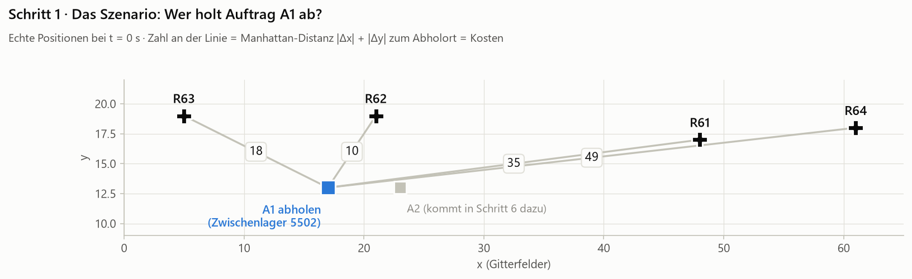
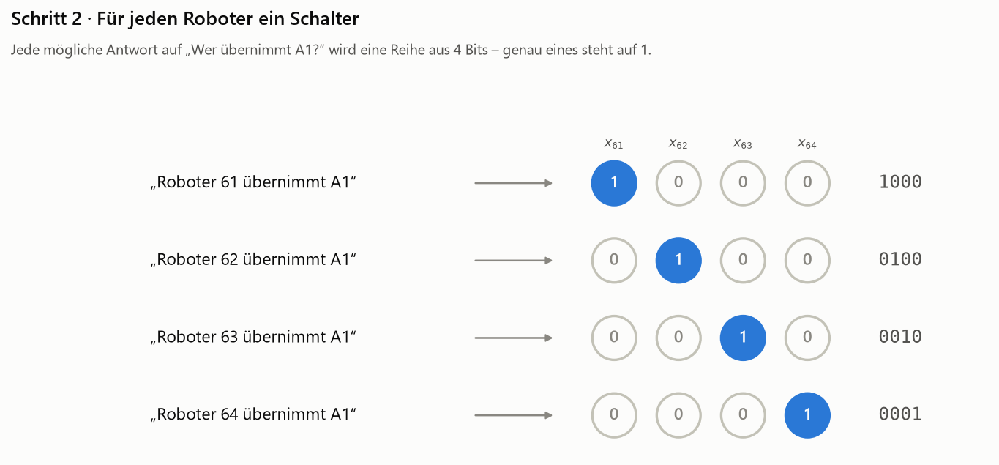
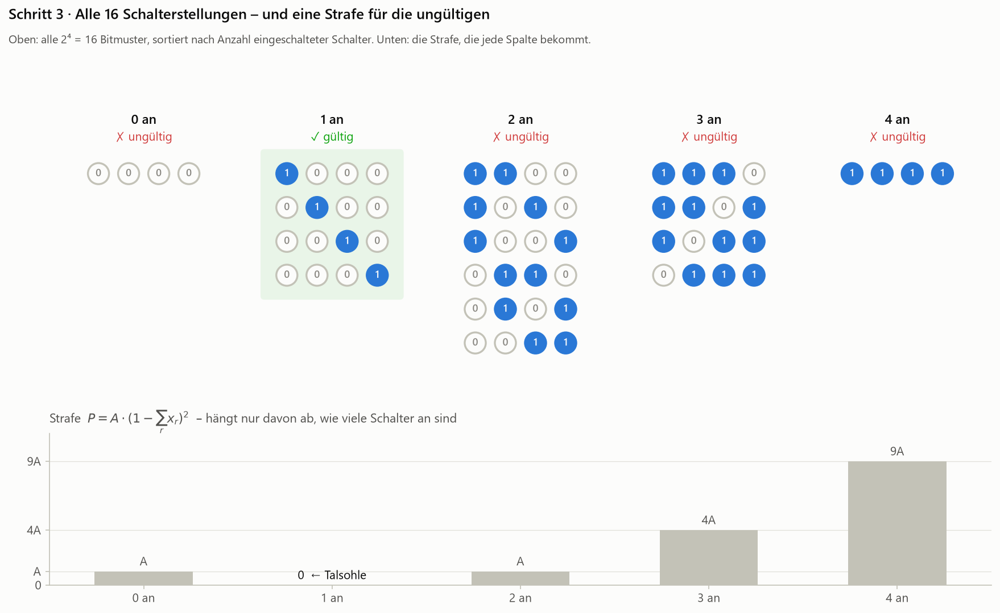
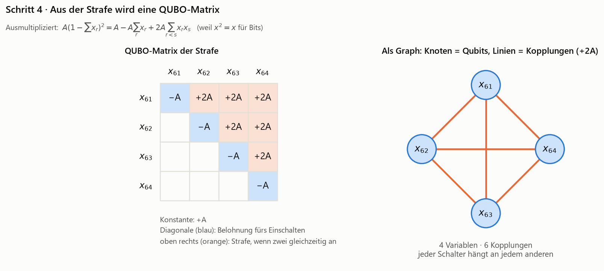
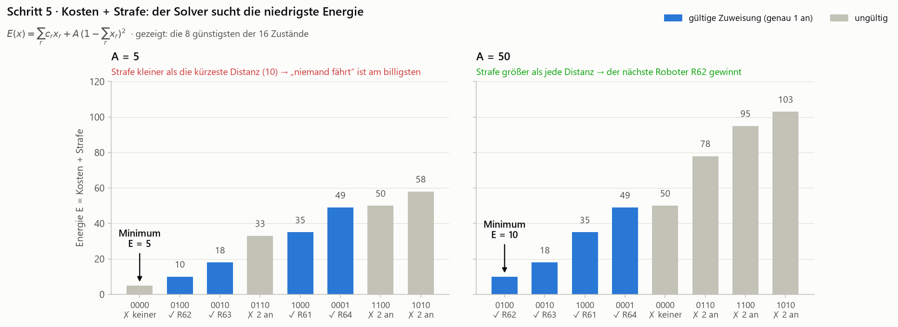
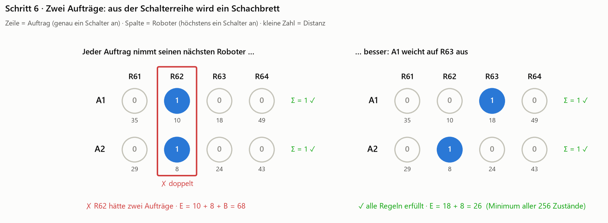
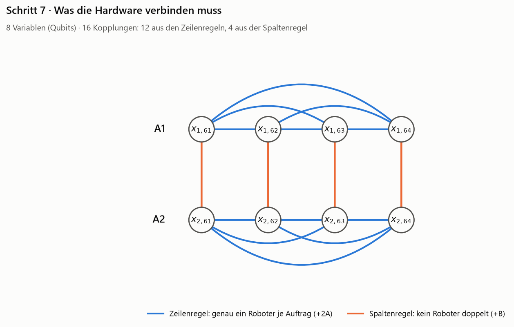
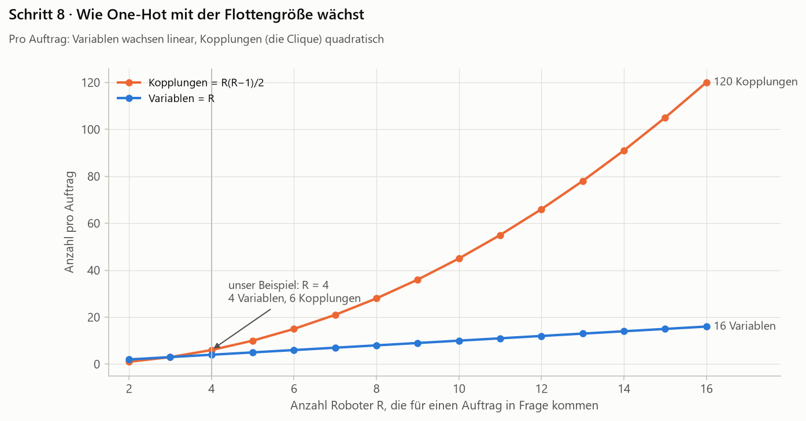

# One-Hot-Kodierung – „Für jeden Roboter ein Schalter“

> **Stand 26.10.2026 – keine Spaltenregel mehr.** Im Projekt ist Doppelbelegung zulässig: Ein Roboter darf mehrere Aufträge übernehmen.
> Das Lernlabor und der Standard in [`formulations.py`](../formulations.py) verwenden deshalb keine Spaltenregel. Die Abschnitte zur
> Spaltenregel unten beschreiben die strengere Variante aus der Literatur (höchstens ein Auftrag je Roboter); sie ist mit
> `column_rule=True` weiter nachrechenbar und im Formel-Baukasten als Baustein „Gruppe je Roboter, höchstens eine Option“ baubar.

> **Kurzfassung:** Für jede mögliche Antwort auf „Welcher Roboter übernimmt den Auftrag?“ gibt es ein eigenes Bit. Genau eines davon soll auf 1 stehen – das „heiße“ Bit (*one hot*). Weil ein Quantenoptimierer keine Regeln kennt, sondern nur eine Energie minimiert, wird die Regel „genau eins“ als **Strafterm** in die Energie eingebaut. Der Preis: viele Variablen und eine Kopplung zwischen *jedem* Paar von Bits.

Wir gehen in acht Schritten vor. Jeder Schritt hat ein Bild – erst das Bild anschauen, dann den Text lesen.

1. [Das Szenario](#schritt-1--das-szenario)
2. [Für jeden Roboter ein Schalter](#schritt-2--für-jeden-roboter-ein-schalter)
3. [Bits kennen keine Regeln – also bestrafen wir](#schritt-3--bits-kennen-keine-regeln--also-bestrafen-wir)
4. [Aus der Strafe wird eine QUBO-Matrix](#schritt-4--aus-der-strafe-wird-eine-qubo-matrix)
5. [Kosten dazu – und wie groß die Strafe sein muss](#schritt-5--kosten-dazu--und-wie-groß-die-strafe-sein-muss)
6. [Zwei Aufträge: das Schachbrett](#schritt-6--zwei-aufträge-das-schachbrett)
7. [Was die Hardware verbinden muss](#schritt-7--was-die-hardware-verbinden-muss)
8. [Wie One-Hot mit der Flottengröße wächst](#schritt-8--wie-one-hot-mit-der-flottengröße-wächst)

---

## Schritt 1 · Das Szenario



Wir nehmen einen echten Moment aus der Simulation: **t = 0 s**. Alle vier Roboter stehen an ihrer Basis und sind frei. Auftrag **A1** will Material am Zwischenlager 5502 abholen lassen.

Als Kosten nehmen wir die Strecke, die ein Roboter bis zum Abholort fahren müsste (Manhattan-Distanz im Gitter, also $|\Delta x| + |\Delta y|$):

| Roboter | R61 | R62 | R63 | R64 |
| --- | --- | --- | --- | --- |
| Distanz zu A1 | 35 | **10** | 18 | 49 |

Für uns ist die Antwort sofort klar: **R62**, er ist am nächsten. Ein Quantenoptimierer kann aber keine Frage „Welcher Roboter?“ verstehen. Er kennt nur zwei Dinge:

- **Bits**, die 0 oder 1 sein können, und
- eine **Energie** – eine Zahl, die er aus den Bits berechnet und so klein wie möglich machen will.

Die ganze Kunst besteht also darin, unsere Frage in *Bits plus Energie* zu übersetzen. Genau das ist eine **Kodierung**. One-Hot ist die naheliegendste.

---

## Schritt 2 · Für jeden Roboter ein Schalter



Die Idee: Wir stellen uns eine Tafel mit vier Lampen vor – eine pro Roboter. Leuchtet die Lampe von Roboter 62, heißt das: „R62 übernimmt A1“.

Mathematisch ist jede Lampe ein Bit:

$$x_r = \begin{cases} 1 & \text{Roboter } r \text{ übernimmt A1} \\ 0 & \text{sonst} \end{cases} \qquad r \in \{61, 62, 63, 64\}$$

Das Bild zeigt das **Codebuch**: Jede der vier möglichen Antworten wird zu einer Reihe aus vier Bits, in der genau ein Bit auf 1 steht – daher der Name *one hot* („eine heiß“). Die Antwort „R62“ heißt in Bits `0100`.

> **Merke:** One-Hot braucht **so viele Bits, wie es Antwortmöglichkeiten gibt** – hier 4 Bits für 4 Roboter.

---

## Schritt 3 · Bits kennen keine Regeln – also bestrafen wir



Jetzt kommt der Haken. Vier Bits haben nicht vier, sondern $2^4 = 16$ mögliche Stellungen (oben im Bild). Nur die vier in der grünen Spalte sind sinnvolle Antworten. Die anderen bedeuten Unsinn:

- `0000` – *niemand* übernimmt A1,
- `0110` – *zwei* Roboter fahren gleichzeitig los,
- `1111` – alle fahren los.

Die Hardware darf jede dieser 16 Stellungen einnehmen. Wir können ihr nicht sagen „halte dich an die Regel *genau eins*“, denn das Format, das sie versteht, heißt **QUBO** – *Quadratic **Unconstrained** Binary Optimization*. „Unconstrained“ bedeutet: **keine Nebenbedingungen erlaubt**.

Der Trick: Wir bauen die Regel in die Energie ein, als **Strafe**, die nur dann null ist, wenn die Regel erfüllt ist:

$$P(x) = A \cdot \Big(1 - \sum_r x_r\Big)^2$$

Gehen wir das langsam durch – die Strafe hängt nur davon ab, *wie viele* Lampen leuchten:

| Lampen an | $1 - \sum x_r$ | quadriert | Strafe $P$ |
| --- | --- | --- | --- |
| 0 | 1 | 1 | $A$ |
| **1** | **0** | **0** | **0** |
| 2 | −1 | 1 | $A$ |
| 3 | −2 | 4 | $4A$ |
| 4 | −3 | 9 | $9A$ |

Das Quadrat sorgt dafür, dass sowohl „zu wenige“ als auch „zu viele“ bestraft werden. Das untere Bild zeigt es als Landschaft: Es gibt **eine Talsohle**, und die liegt genau bei „1 an“. $A$ ist ein Gewicht, das wir selbst wählen – dazu mehr in Schritt 5.

---

## Schritt 4 · Aus der Strafe wird eine QUBO-Matrix



Ein QUBO darf nur zwei Arten von Termen enthalten: **einzelne Bits** ($x_i$) und **Paare von Bits** ($x_i x_j$). Das „Q“ steht für *quadratisch* – mehr als zwei Bits in einem Produkt sind nicht erlaubt. Formal:

$$E(x) = \sum_i Q_{ii}\, x_i + \sum_{i<j} Q_{ij}\, x_i x_j + \text{const}$$

Unsere Strafe ist ein Quadrat, wir müssen sie also ausmultiplizieren. Dabei hilft eine Eigenschaft von Bits: $x^2 = x$ (denn $0^2 = 0$ und $1^2 = 1$).

$$
\begin{aligned}
A\Big(1 - \sum_r x_r\Big)^2
&= A\Big(1 - 2\sum_r x_r + \big(\textstyle\sum_r x_r\big)^2\Big) \\
&= A\Big(1 - 2\sum_r x_r + \sum_r x_r + 2\sum_{r<s} x_r x_s\Big) \\
&= A \;-\; A\sum_r x_r \;+\; 2A\sum_{r<s} x_r x_s
\end{aligned}
$$

Das lässt sich direkt in die Matrix übertragen (linkes Bild):

- **Diagonale $-A$** (blau): Jedes Bit bekommt eine *Belohnung*, wenn es angeht. Jede Lampe „will“ leuchten.
- **Oberhalb der Diagonale $+2A$** (orange): Jedes *Paar* von Bits bekommt eine Strafe, wenn beide an sind. Die Lampen sind untereinander „verfeindet“.
- **Konstante $+A$**: verschiebt alles nur nach oben, ändert nichts an der Lösung.

Der Kompromiss aus „jeder will an“ und „keine zwei gleichzeitig“ ist genau: **eine an**. Zur Probe mit `0110` (zwei an): $-A - A + 2A + A = A$ ✓ – passt zur Tabelle aus Schritt 3.

**Das rechte Bild ist das Wichtigste für die Hardware.** Zeichnet man jedes Bit als Knoten und jeden Paar-Term als Linie, entsteht ein Graph, in dem **jeder Knoten mit jedem verbunden ist** – eine sogenannte *Clique*. In der Hardware bedeutet jede Linie: Diese beiden Qubits müssen miteinander wechselwirken können.

---

## Schritt 5 · Kosten dazu – und wie groß die Strafe sein muss



Bisher sorgt die Energie nur dafür, dass *irgendein* Roboter gewählt wird. Jetzt soll es der *günstigste* sein. Dafür addieren wir die Kosten – sie sind einfach linear, jeder Roboter bringt seine Distanz mit:

$$E(x) = \underbrace{\sum_r c_r\, x_r}_{\text{Kosten}} + \underbrace{A\Big(1-\sum_r x_r\Big)^2}_{\text{Strafe}}$$

In der Matrix landen die Kosten auf der Diagonale: $Q_{rr} = c_r - A$.

Und jetzt die entscheidende Frage: **Wie groß muss $A$ sein?** Das Bild zeigt beide Fälle mit echten Zahlen.

**Links, $A = 5$ – zu klein.** Die Stellung `0000` („niemand fährt“) kostet nichts an Strecke und bekommt nur die Strafe $A = 5$. Die beste gültige Antwort `0100` kostet 10. Der Optimierer wählt also *keinen* Roboter – die Regel zu brechen ist billiger, als sie einzuhalten.

**Rechts, $A = 50$ – ausreichend.** Jetzt kostet `0000` schon 50, mehr als jede echte Fahrt. Das Minimum ist `0100` mit $E = 10$: **R62**, genau wie wir es erwartet haben.

> **Faustregel:** Die Strafe muss größer sein als alles, was man durch einen Regelbruch „sparen“ könnte. Hier spart „niemand fährt“ höchstens die kürzeste Distanz (10), also muss $A > 10$ sein. Wir nehmen $A = 50$, größer als jede Distanz im Beispiel.

**Aber nicht beliebig groß!** Wählt man $A = 10\,000$, sind die Unterschiede, auf die es ankommt (10 vs. 18), winzig im Vergleich zur größten Zahl in der Matrix. Reale Hardware kann Koeffizienten nur mit begrenzter Genauigkeit einstellen, und Rauschen kommt hinzu. Die Kostenunterschiede gehen dann darin unter. Die Wahl von $A$ ist also ein Balanceakt – und genau hier entsteht eine **Präzisionsanforderung an die Hardware**.

---

## Schritt 6 · Zwei Aufträge: das Schachbrett



Bei t = 0 s kommt gleichzeitig Auftrag **A2** (Zwischenlager 5508) dazu. Seine Distanzen:

| Roboter | R61 | R62 | R63 | R64 |
| --- | --- | --- | --- | --- |
| Distanz zu A2 | 29 | **8** | 24 | 43 |

Jetzt brauchen wir für **jede Kombination aus Auftrag und Roboter** ein Bit: $x_{t,r}$ = „Auftrag $t$ wird von Roboter $r$ übernommen“. Das sind $2 \times 4 = 8$ Bits, die man sich als **Schachbrett** vorstellen kann: Zeilen sind Aufträge, Spalten sind Roboter.

Zwei Regeln:

1. **Zeilenregel – jeder Auftrag genau einen Roboter.** Das ist unsere One-Hot-Strafe aus Schritt 3, einmal pro Zeile: $A(1-\sum_r x_{1,r})^2 + A(1-\sum_r x_{2,r})^2$.
2. **Spaltenregel – kein Roboter bekommt zwei Aufträge.** Dafür reicht ein einfacher Paar-Term pro Spalte: $B \cdot x_{1,r}\, x_{2,r}$. Er ist nur dann nicht null, wenn *beide* Aufträge denselben Roboter wählen.

**Links** sieht man, warum die Spaltenregel nötig ist: Beide Aufträge haben R62 als nächsten Roboter. Würde jeder Auftrag stur seinen nächsten nehmen, hätte R62 zwei Aufträge. Das kostet $10 + 8 + B = 68$.

**Rechts** ist das echte Minimum über alle $2^8 = 256$ Stellungen: **A1 → R63, A2 → R62** mit $E = 18 + 8 = 26$. Interessant: A1 bekommt *nicht* seinen nächsten Roboter. Der Optimierer findet die beste Lösung *für beide zusammen* – das ist der Kern der Multi-Robot Task Allocation.

> Auch $B$ muss groß genug sein: Die Doppelbelegung „spart“ gegenüber dem Optimum $26 - 18 = 8$, also muss $B > 8$ sein. Wir nehmen $B = 50$.

---

## Schritt 7 · Was die Hardware verbinden muss



Zeichnen wir wieder jedes Bit als Knoten und jeden Paar-Term als Linie:

- **Blau:** Jede Zeile ist eine Clique wie in Schritt 4 – je 6 Linien, zusammen 12.
- **Orange:** Jede Spalte verbindet die beiden Bits desselben Roboters – 4 Linien.

Zusammen: **8 Variablen, 16 Kopplungen.** Allgemein, für $T$ Aufträge und $R$ Roboter:

$$\text{Variablen} = T \cdot R \qquad \text{Kopplungen} = \underbrace{T \cdot \tfrac{R(R-1)}{2}}_{\text{Zeilen}} + \underbrace{R \cdot \tfrac{T(T-1)}{2}}_{\text{Spalten}}$$

Warum ist das für die Hardware wichtig? Echte Quantenchips verbinden **nicht jedes Qubit mit jedem**. Fehlt eine benötigte Verbindung, muss man sie nachbauen:

- auf einem Quantum Annealer, indem man eine Variable auf eine *Kette* mehrerer physikalischer Qubits verteilt (*Minor Embedding*),
- auf einem gatterbasierten Rechner, indem man Qubits per SWAP-Operationen nebeneinander tauscht.

Beides kostet zusätzliche Qubits bzw. Rechenschritte. Cliquen sind dabei die teuerste Struktur. Wie teuer genau, ist Thema von Stufe 4 (Hardware-Mapping).

---

## Schritt 8 · Wie One-Hot mit der Flottengröße wächst



Pro Auftrag hängt alles an der Zahl $R$ der Roboter, die in Frage kommen:

| Roboter $R$ | Variablen ($R$) | Kopplungen der Clique ($R(R-1)/2$) |
| --- | --- | --- |
| 4 (unser Beispiel) | 4 | 6 |
| 8 | 8 | 28 |
| 16 | 16 | 120 |

Die Variablen wachsen **linear**, die Kopplungen **quadratisch**. Bei kleinen Flotten wie in unseren Daten (Ø 2 Kandidaten pro Auftrag, siehe [Analysebericht](../../outputs/2026-10-09_12-59-39/bericht.md)) ist das harmlos. Bei großen Flotten wird die Clique zum dominierenden Kostenfaktor.

Genau hier setzen die beiden anderen Kodierungen an:

- **Domain Wall** kommt mit $R-1$ Bits pro Auftrag aus und ersetzt die Clique durch eine **Kette**.
- **Binary** braucht nur $\lceil \log_2 R \rceil$ Bits, bezahlt das aber an anderer Stelle.

Was „an anderer Stelle“ heißt, sehen wir in den nächsten Kapiteln: weiter mit [Domain Wall](../domain_wall/README.md).

---

## Auf einen Blick

| | One-Hot |
| --- | --- |
| Idee | ein Bit pro Antwortmöglichkeit, genau eines ist 1 |
| Bits pro Auftrag | $R$ |
| Gültige Zustände pro Auftrag | $R$ von $2^R$ |
| Strafe für „genau eins“ | $A(1-\sum_r x_r)^2$ |
| Kopplungen dieser Strafe | $R(R-1)/2$ – jeder mit jedem (Clique) |
| Kosten | linear, direkt auf der Diagonale ablesbar |
| Stärken | sehr anschaulich, Kosten einfach einzubauen, Lösung direkt ablesbar |
| Schwächen | viele Variablen, dichte Kopplung, Strafgewicht $A$ muss sorgfältig gewählt werden |

## Zum Nachrechnen

```powershell
python encodings/one_hot/illustrate.py
```

Das Skript erzeugt alle Abbildungen neu und prüft dabei **jede Zahl dieses Textes** durch Ausprobieren aller Zustände (16 für einen Auftrag, 256 für zwei). Ändert man das Beispiel in [`../common.py`](../common.py), schlägt die Prüfung fehl, falls der Text nicht mehr stimmt.

## Literatur

- A. Lucas, „Ising formulations of many NP problems“, *Frontiers in Physics* 2, 5 (2014). [doi:10.3389/fphy.2014.00005](https://doi.org/10.3389/fphy.2014.00005) – Standardreferenz für Strafterm-Formulierungen wie „genau eins“.
